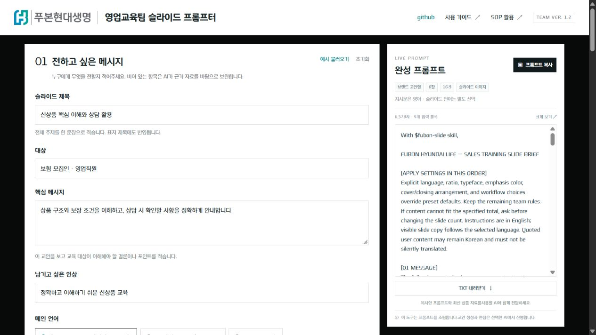
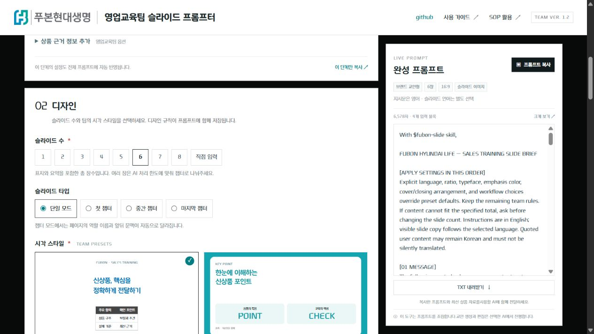
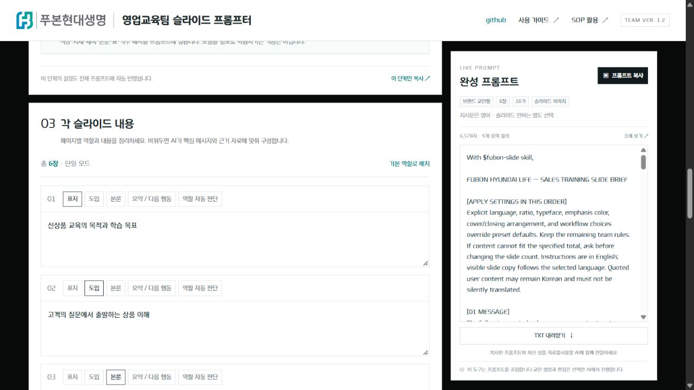
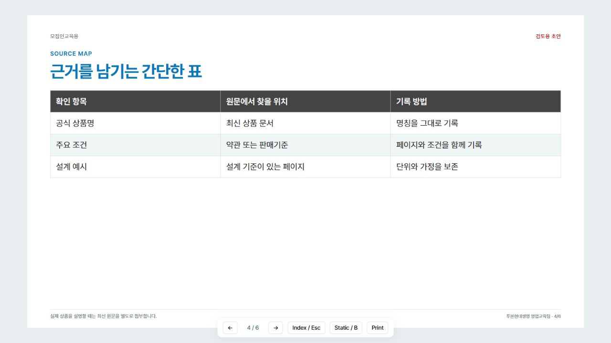
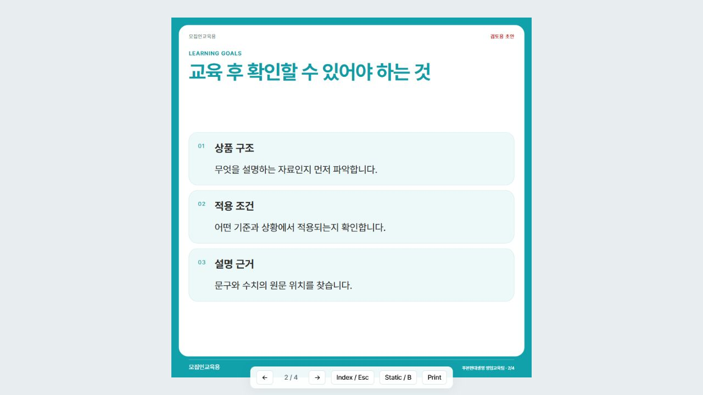
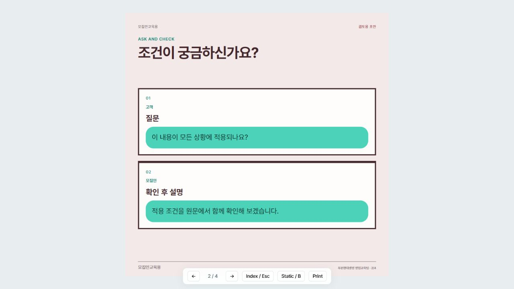

<p align="center">
  <picture>
    <source media="(prefers-color-scheme: dark)" srcset="web/assets/brand/fubon-logo-white.png">
    
  </picture>
</p>

# 영업교육팀 슬라이드 프롬프터

**팀의 디자인으로 신상품 교육자료를 준비하는 영문 프롬프트 빌더와 Codex 스킬.**

한국어로 내용을 입력하고, 세 가지 팀 스타일 중 하나를 고르면, 제작에 필요한 영문 지시문이 오른쪽에 모입니다. 완성한 프롬프트를 ChatGPT 또는 Codex에 전달해 교안·카드뉴스·안내장 제작에 활용하세요.

**[프롬프터 바로 열기 →](https://tux2won.github.io/fubon-sales-slide-skill/)** · [Codex 스킬 설치](#codex-스킬-설치) · [v1.2.1 배포 파일](https://github.com/tux2won/fubon-sales-slide-skill/releases/tag/v1.2.1)

[](https://tux2won.github.io/fubon-sales-slide-skill/)

*현재 공개 사이트에서 촬영한 실제 화면입니다. 입력 내용은 사용법을 보여주기 위한 예시입니다. 화면 UI: TEAM VER. 1.2 · 배포 패키지: v1.2.1.*

## 어떤 링크를 사용하면 되나요?

| 링크 | 하는 일 | 언제 사용하나요? |
|---|---|---|
| [프롬프터 웹사이트](https://tux2won.github.io/fubon-sales-slide-skill/) | 프롬프트를 입력·선택·복사하는 실제 도구 | 평소 작업할 때, 팀원에게 공유할 때 |
| [GitHub 저장소](https://github.com/tux2won/fubon-sales-slide-skill) | 최신 소스·README·제작 규칙을 관리하는 작업 공간 | 사용법을 읽거나 UI·규칙을 수정할 때 |
| [릴리스 v1.2.1](https://github.com/tux2won/fubon-sales-slide-skill/releases/tag/v1.2.1) | 해당 버전을 확정해 둔 설명과 ZIP 다운로드 | 특정 버전을 내려받거나 보관할 때 |

저장소의 `main`은 수정할 때마다 바뀌고, **릴리스는 그 버전의 기록으로 남습니다.** README를 수정해도 이미 배포한 v1.2.1 ZIP이 자동으로 바뀌지는 않습니다. 새 버전의 묶음 파일이 필요하면 별도 릴리스를 만듭니다.

## 1. 영문 프롬프터 사용하기

**왼쪽은 입력, 오른쪽은 완성 프롬프트입니다.** 네 입력 블록을 한 화면에서 아래로 스크롤하며 작업합니다. 데스크톱에서는 오른쪽 프롬프트가 고정되고, 좁은 화면에서는 입력 영역 아래에 배치됩니다.

상단에는 제공받은 푸본현대생명 로고와 **‘영업교육팀 슬라이드 프롬프터’** 제목을 표시합니다. `github` 링크는 이 저장소로 연결되며, 화면의 제목·본문·입력창·프롬프트에는 **Youandi Modern 회사 서체 5종**을 적용했습니다.

| 순서 | 화면의 입력 블록 | 정하는 내용 |
|---|---|---|
| **01** | **전하고 싶은 메시지** | 제목, 대상, 핵심 메시지, 인상, 슬라이드 언어, 바로 제작 또는 구성안 먼저 확인 |
| **02** | **디자인** | 슬라이드 수, 챕터 구분, 저장된 팀 스타일 3종, 비율, 글꼴, 가독성 |
| **03** | **각 슬라이드 내용** | 표지·도입·본론·요약 역할과 페이지별 내용. 비워두면 AI가 제공 자료를 바탕으로 구성 |
| **04** | **고급 설정** | 색상, 페이지 번호, 표지·요약 배치, 크레딧, 사용할 AI와 원하는 결과물 |

1. [프롬프터](https://tux2won.github.io/fubon-sales-slide-skill/)를 열고, 네 블록을 순서대로 작성합니다.
2. **04 고급 설정 → 출력 방식**에서 사용할 AI와 결과물 형식을 선택합니다.
3. 오른쪽 **‘프롬프트 복사’**를 누릅니다. TXT 내려받기도 가능합니다.
4. 선택한 AI에 프롬프트를 붙여넣고 **최신 약관·상품요약서·판매기준 등 근거 자료를 함께 첨부**합니다.

입력 화면은 한국어, 제작 지시문은 영어입니다. 슬라이드에 표시할 언어는 별도 선택하며 기본은 한국어입니다. 입력한 한국어 상품명·본문은 원문을 유지합니다. 영어 지시문 자체가 결과물의 품질을 보장하지는 않습니다.

<details>
<summary><strong>02~04 실제 입력 화면 펼쳐보기</strong></summary>

### 02 디자인

장수와 챕터, 팀 스타일을 선택합니다. 선택한 스타일의 색상·서체·제목·표·각주 규칙이 프롬프트에 반영됩니다.



### 03 각 슬라이드 내용

페이지마다 역할을 지정하고 내용을 입력합니다. 표지·도입·본론·요약의 역할에 따라 레이아웃 지시도 달라집니다.



### 04 고급 설정

색상과 배치, 크레딧을 마무리합니다. 아래쪽 ‘출력 방식’에서 ChatGPT/Codex와 슬라이드 이미지/PPTX/HTML을 선택합니다.


</details>

**작업 이어가기:** ‘이 브라우저에 작업 저장’을 켜면 같은 브라우저에서 입력을 이어갈 수 있습니다. 다른 환경으로 옮길 때는 ‘설정 내보내기 / 가져오기’를 사용하세요.

## 저장된 팀 스타일 3종

| 브랜드 교안형 | 인포그래픽 카드형 | 스토리 웹툰형 |
|---|---|---|
|  |  |  |
| **상품 교안·비교표·안내장** | **핵심 요약·니즈 환기** | **상담 사례·개념 설명** |
| 흰색·파랑·청록, 구조화된 표, 고정 각주 | 큰 제목과 숫자, 파랑·청록, 둥근 흰 패널 | 민트·브라운·핑크, 만화 칸과 말풍선 |
| 스타일 ID: `brand` | 스타일 ID: `info` | 스타일 ID: `story` |

위 세 장은 **스킬의 HTML 템플릿으로 만든 가상 교육 예시**입니다. 실제 상품 자료나 웹사이트 화면이 아닙니다.

실행 예시: [브랜드 교안](https://tux2won.github.io/fubon-sales-slide-skill/examples/classroom/) · [인포그래픽](https://tux2won.github.io/fubon-sales-slide-skill/examples/infographic/) · [스토리](https://tux2won.github.io/fubon-sales-slide-skill/examples/story/)

팀 작업물에서 추출한 색상·서체·배치 규칙을 저장한 방식입니다. 모델을 파인튜닝하거나 원본 교안을 자동 학습하는 기능은 아닙니다. 색상과 배치는 관찰에 따른 근사 규칙이며 공식 CI값을 인증한 것은 아닙니다.

<a id="codex-스킬-설치"></a>

## 2. Codex 스킬 설치

프롬프터에서 AI를 **Codex**로 선택하면 영문 프롬프트가 `With $fubon-slide skill,`로 시작합니다. 아래 스킬을 설치하면 팀 규칙과 템플릿을 함께 사용할 수 있습니다.

```sh
npx skills add tux2won/fubon-sales-slide-skill --skill fubon-slide
```

설치 대상에서 Codex를 선택하세요. [오픈소스 skills CLI](https://github.com/vercel-labs/skills)를 사용하며, 이 저장소의 npm 의존성을 별도로 설치할 필요는 없습니다. 설치 후 다음 대화에서 `$fubon-slide`로 호출하세요. 목록에 나타나지 않으면 Codex를 재시작하세요.

직접 설치할 때는 [`skills/fubon-slide`](skills/fubon-slide) 폴더를 사용자 스킬 폴더 `~/.codex/skills/fubon-slide` 또는 프로젝트의 `.agents/skills/fubon-slide`에 복사할 수 있습니다. [공식 스킬 문서](https://developers.openai.com/codex/skills/)

### 영문 사용 예시

```text
With $fubon-slide skill,
Create a 6-slide Korean new-product training deck for insurance sales staff.
Use the saved Brand classroom style and the latest source files I attach.
Keep all product conditions and source pages. Mark unknowns as [확인 필요].
First show the proposed structure, then wait for my approval.
Output: editable HTML, 16:9.
```

| 원하는 결과물 | 제작 방식 |
|---|---|
| **편집 가능한 HTML** | 포함된 S01–S22 레이아웃과 실제 HTML 렌더러 사용 |
| **편집 가능한 PPTX** | 사용하는 AI 환경의 실제 프레젠테이션 제작 기능 필요 |
| **슬라이드 이미지** | 사용하는 AI 환경의 실제 이미지 생성 기능 필요. 이미지 속 글자는 PPT 텍스트처럼 직접 편집할 수 없음 |

ChatGPT를 선택하면 스킬 호출문 없이 상세 제작 규칙을 포함한 프롬프트를 만듭니다. 웹사이트 자체는 AI API를 호출하지 않으며, 교안 생성은 프롬프트를 전달받은 AI에서 진행합니다.

## UI와 제작 규칙 수정하기

| 바꾸고 싶은 것 | 수정할 파일 |
|---|---|
| 사이트 제목·로고·헤더 링크 | [`web/index.html`](web/index.html) |
| 화면 색상·간격·배치 | [`web/app.css`](web/app.css), [`web/components.css`](web/components.css) |
| 입력 항목·선택지·도움말 | [`web/app.js`](web/app.js) |
| 복사되는 영문 제작 지시문 | [`web/prompt-core.js`](web/prompt-core.js) |
| 웹사이트 서체 연결 | [`web/fonts.css`](web/fonts.css) |
| 저장된 팀 스타일 규칙 | [`skills/fubon-slide/references/styles.json`](skills/fubon-slide/references/styles.json) 수정 후 `npm run sync` |

GitHub에서 파일의 **연필 버튼 → 수정 → `main`에 커밋**하면 GitHub Pages가 다시 게시합니다. **Actions → pages-build-deployment**의 성공을 확인한 뒤 사이트를 새로고침하세요. 스타일 규칙을 수정했다면 로컬에서 동기화한 웹 파일도 함께 커밋합니다.

웹사이트의 원본은 이 저장소의 `web/`입니다. 별도 복사본 대신 같은 파일을 게시하며, 다음 명령으로 공개 사이트의 15개 파일과 원본의 SHA-256 일치를 검증할 수 있습니다.

```sh
node scripts/verify-pages.mjs
```

현재 공유 주소는 **[GitHub Pages](https://tux2won.github.io/fubon-sales-slide-skill/)**입니다. 기존 ChatGPT Sites 주소에는 이전 UI가 남아 있습니다. [배포 설명](docs/DEPLOYMENT.md) · [검증 기록](docs/VALIDATION.md)

<details>
<summary><strong>로컬 템플릿 실행과 개발 명령</strong></summary>

Node.js 20 이상으로 HTML 템플릿을 실행할 수 있으며 `npm install`이 필요하지 않습니다.

```sh
node skills/fubon-slide/scripts/build-deck.mjs examples/classroom/slide_plan.json --out output/my-deck
node skills/fubon-slide/scripts/validate-deck.mjs output/my-deck/index.html
```

생성된 `index.html`을 브라우저로 여세요. 방향키·스와이프 이동, Esc 목차, B 정적 모드, 인쇄를 지원합니다.

제작 순서: `DESIGN.md` → `slide_plan.json` → `slide_prompts.json` → 실제 결과물 → 구조·화면·사실 검수.

```sh
npm test
npm run examples
npm run sync
node scripts/export-web.mjs --out <배포 폴더>
```

테스트는 레이아웃 구조·출처 ID·수치의 단위와 기준·실제 파일 생성·영문 프롬프트 등을 확인합니다. 상품 사실이나 모든 입력 길이에서의 시각 품질을 자동 보증하지는 않습니다. 정적 내보내기는 `--check-only`로 복사 없이 비교할 수도 있습니다.

</details>

## 출처와 자산

[Future Slide](https://github.com/humantonylee/future-slide)의 공개된 레이아웃 잠금 방식을 영업교육팀 용도로 확장했습니다. 원작 코드·개념과의 대응은 [NOTICE](NOTICE)에 기록했습니다.

소프트웨어와 작성된 제작 규칙은 [Apache-2.0](LICENSE)으로 제공합니다. 회사 명칭·상표·별도 첨부 자산·폰트의 권리는 이 라이선스에 포함되지 않습니다. 웹사이트 로고와 회사 서체 5종은 [`web/assets`](web/assets)에 있으며 [자산 권리 안내](web/assets/RIGHTS.md)를 따릅니다. 스킬로 자료를 제작할 때 필요한 원본 자산은 작업 환경에 맞게 별도로 제공하세요.

이 프로젝트는 독립 제작한 팀용 도구이며 공식 회사 배포본이나 CI 매뉴얼은 아닙니다. 원본 교안과 실제 상품 자료는 공개 저장소에 포함하지 않습니다. 프로젝트별 근거는 로컬에서 관리하고, 담당자가 결과물의 최신성·조건·배포 범위를 확인합니다.
